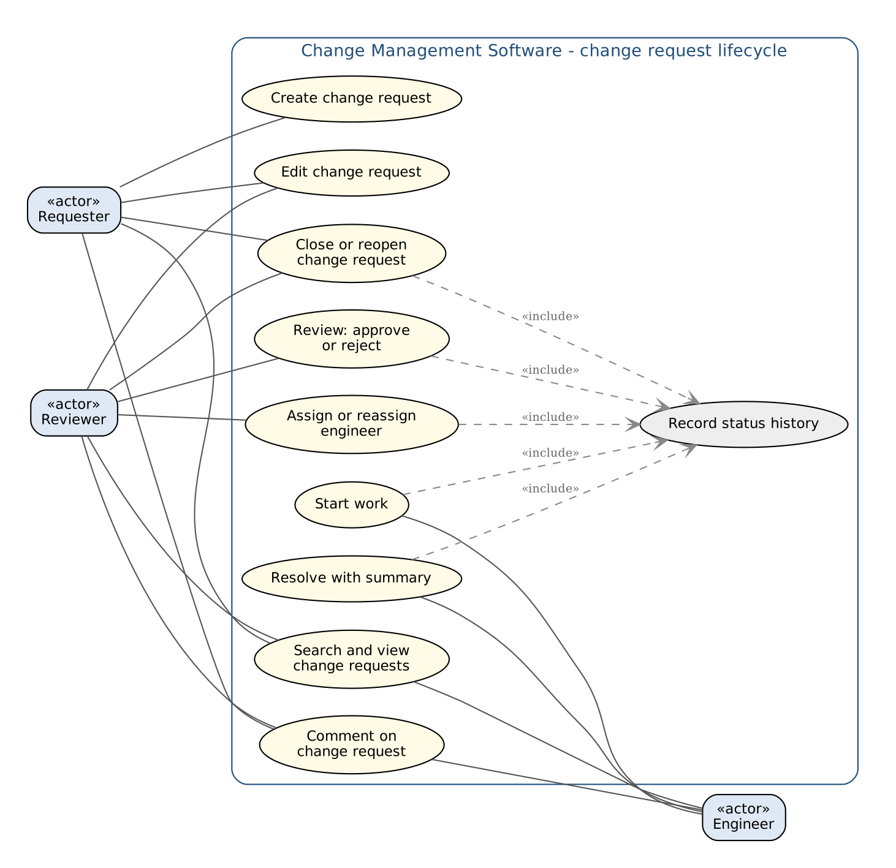
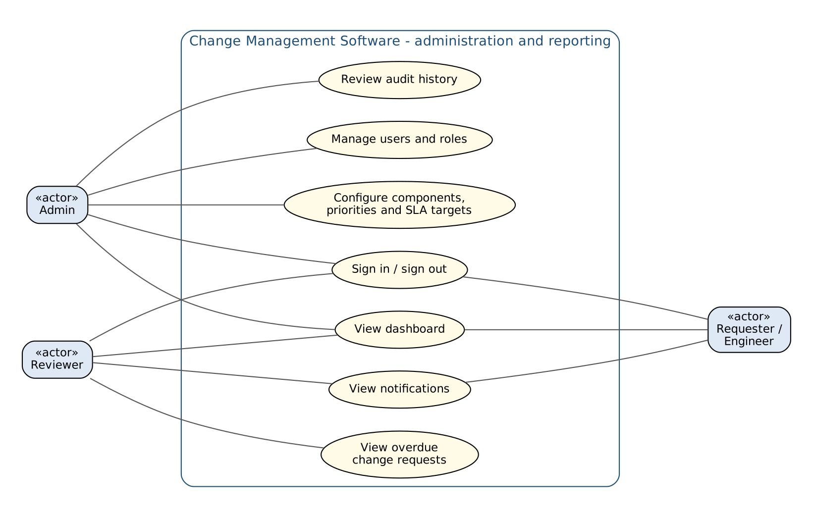
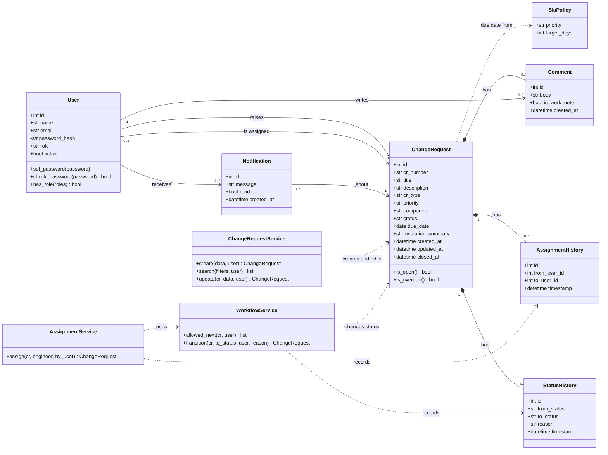
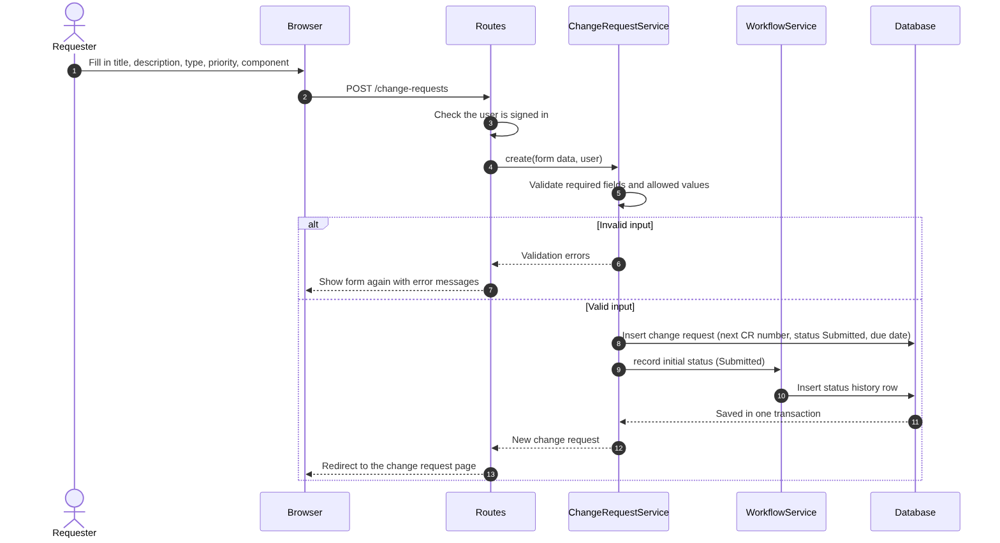
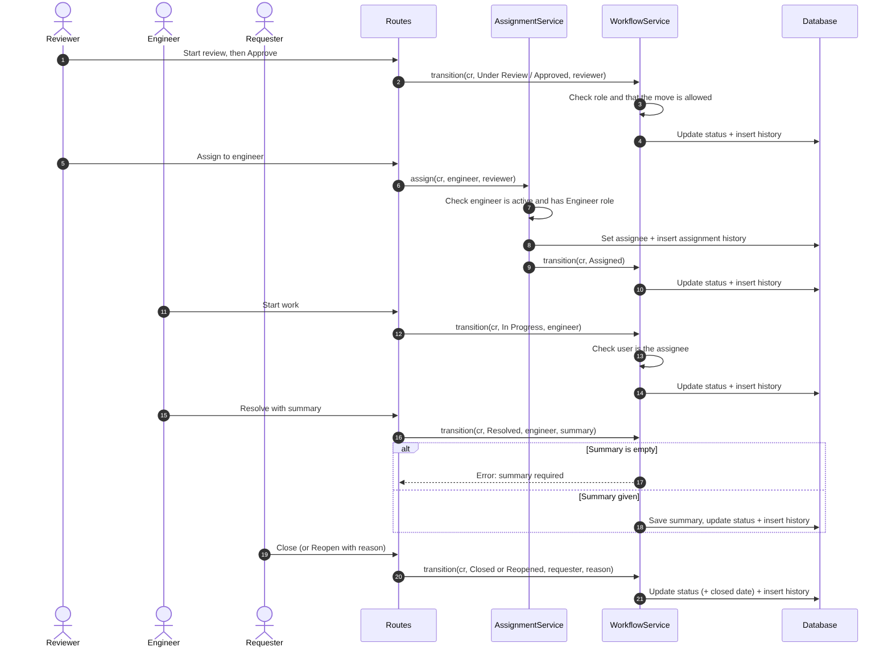
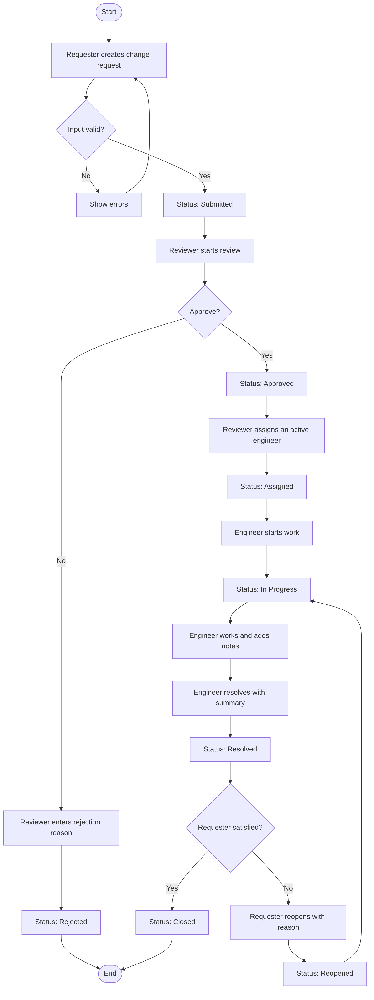
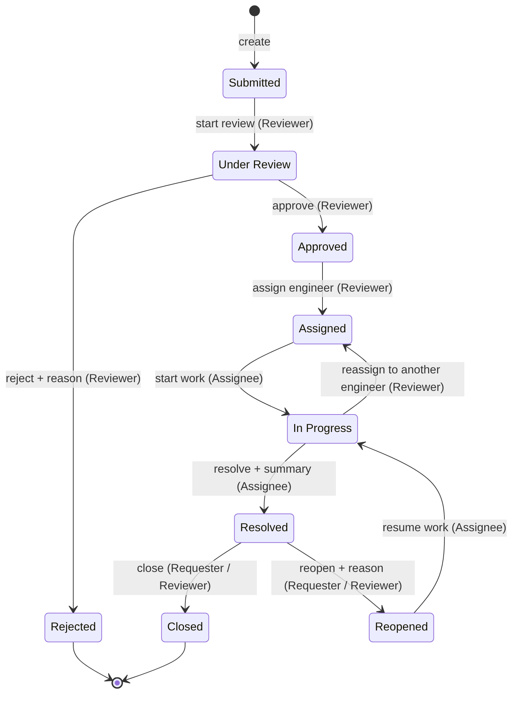
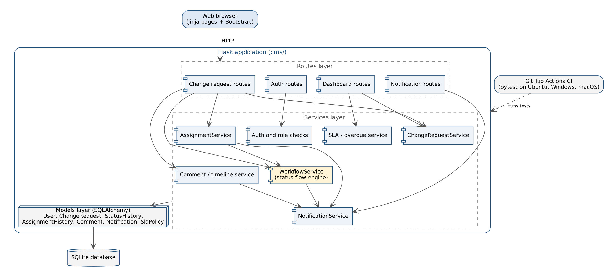

# UML diagrams - Change Management Software

These diagrams describe the system planned in the [SRS](CMS_SRS.pdf) and [SAD](CMS_SAD.pdf) and built in the Jira stories CMS-1 to CMS-15. Keep them in step with the code: if a story changes the design, update the diagram in the same pull request.

Sources are in [`docs/diagrams/`](diagrams/):

- `.dot` files are Graphviz. Render with `dot -Tpng file.dot -o file.png`.
- `.mmd` files are Mermaid. GitHub shows them directly. Render with `mmdc -i file.mmd -o file.png`, or paste them into draw.io (*Arrange → Insert → Advanced → Mermaid*).

| # | Diagram | File |
|---|---|---|
| 1 | Use case: change request lifecycle | [use-case-lifecycle.dot](diagrams/use-case-lifecycle.dot) |
| 2 | Use case: administration and reporting | [use-case-admin.dot](diagrams/use-case-admin.dot) |
| 3 | Class diagram | [class.mmd](diagrams/class.mmd) |
| 4 | Sequence: create a change request | [sequence-create.mmd](diagrams/sequence-create.mmd) |
| 5 | Sequence: approve, assign, resolve, close | [sequence-lifecycle.mmd](diagrams/sequence-lifecycle.mmd) |
| 6 | Activity: change request lifecycle | [activity-lifecycle.mmd](diagrams/activity-lifecycle.mmd) |
| 7 | State machine: change request status | [state.mmd](diagrams/state.mmd) |
| 8 | Component diagram | [component.dot](diagrams/component.dot) |

---

## 1. Use case diagram: change request lifecycle

Three actors work on a change request (CR):

- **Requester** raises, edits, comments on, and finally closes or reopens their own CRs.
- **Reviewer** reviews new CRs (approve or reject), assigns engineers, and can also edit, comment, close or reopen.
- **Engineer** starts work on CRs assigned to them and resolves them with a summary.

Every use case that changes the status *includes* **Record status history**, so no status change can happen without a history entry (SRS CMS-F-013).

## 2. Use case diagram: administration and reporting

The **Admin** manages users and roles, configures components, priorities and due-date (SLA) targets, and reviews audit history. All users sign in and see the dashboard and their notifications. Reviewers also watch the overdue list.

## 3. Class diagram

- **User** holds the role (Requester, Reviewer, Engineer, Admin) and a hashed password, never the plain one.
- **ChangeRequest** is the central class. Each CR has one requester and at most one assignee.
- **StatusHistory**, **AssignmentHistory** and **Comment** belong to one CR (composition: they make no sense without it). Together they form the CR's activity timeline.
- **Notification** tells a user about something that happened to a CR.
- **SlaPolicy** gives the target number of days per priority, used to set the CR's due date.
- The **services** hold the rules. `WorkflowService` is the only class allowed to change a CR's status. `AssignmentService` uses it when assigning, and `ChangeRequestService` handles creating, searching and editing.

`User` and `ChangeRequest` already exist in the code (CMS-1). The other classes are added by their stories: StatusHistory (CMS-5), AssignmentHistory (CMS-7), Comment (CMS-10), SlaPolicy (CMS-13), Notification (CMS-14).

## 4. Sequence diagram: create a change request

The requester submits the form, and the route checks they are signed in. `ChangeRequestService` validates the input. Invalid input goes back to the form with error messages and nothing is saved. Valid input saves the CR with the next CR number and status **Submitted**, and the first status-history row is written in the same database transaction (CMS-3, CMS-5).

## 5. Sequence diagram: approve, assign, resolve, close

This is the main path through the system:

1. The reviewer approves. `WorkflowService` checks the role and that the move is allowed (CMS-6).
2. The reviewer assigns an engineer. `AssignmentService` checks the engineer is active and has the Engineer role, records the assignment, then asks `WorkflowService` to move the CR to **Assigned** (CMS-7).
3. The engineer starts work and later resolves. Only the assignee may do this, and resolving needs a summary (CMS-8).
4. The requester closes the CR, or reopens it with a reason (CMS-9).

Every step writes a history row.

## 6. Activity diagram: change request lifecycle

This shows the same lifecycle as a flow of activities with the decision points: is the input valid, is the CR approved, and is the requester satisfied with the fix. A rejected or closed CR ends the flow. A reopened CR goes back to **In Progress** with the same engineer.

## 7. State machine diagram: change request status

This is the exact transition table the status-flow engine (CMS-5) enforces. Any move not drawn here, for example **Submitted → Closed**, must be rejected. The label on each arrow shows the action and who may perform it. **Rejected** and **Closed** are final states.

## 8. Component diagram

The application is a **layered modular monolith** (SAD section 4):

- **Routes** receive the browser's HTTP requests and render pages.
- **Services** hold all business rules. Routes never change data directly.
- **Models** (SQLAlchemy) map classes to tables in the **SQLite** database.

`WorkflowService`, `AssignmentService` and the comment service call `NotificationService` after a successful change. GitHub Actions runs the test suite against the whole application on every pull request.
