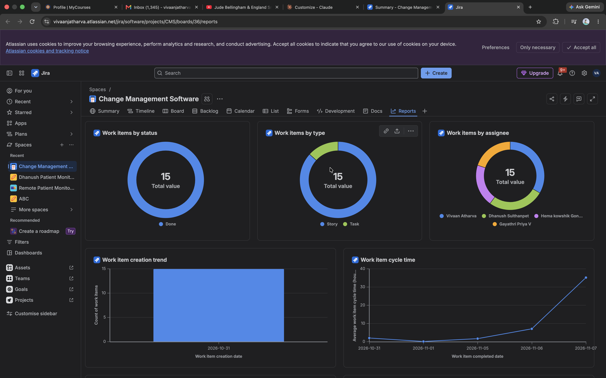
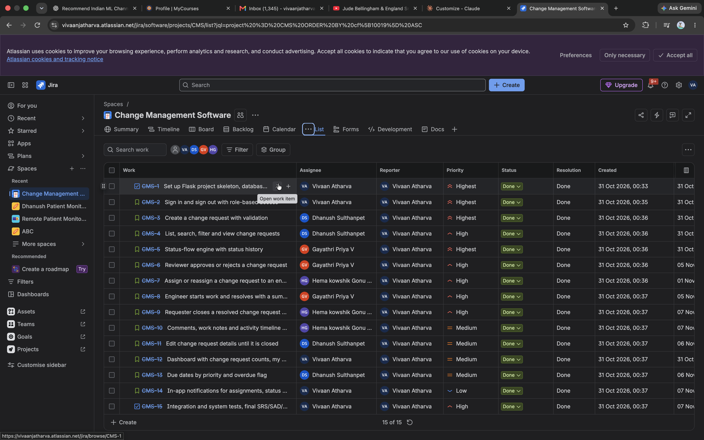
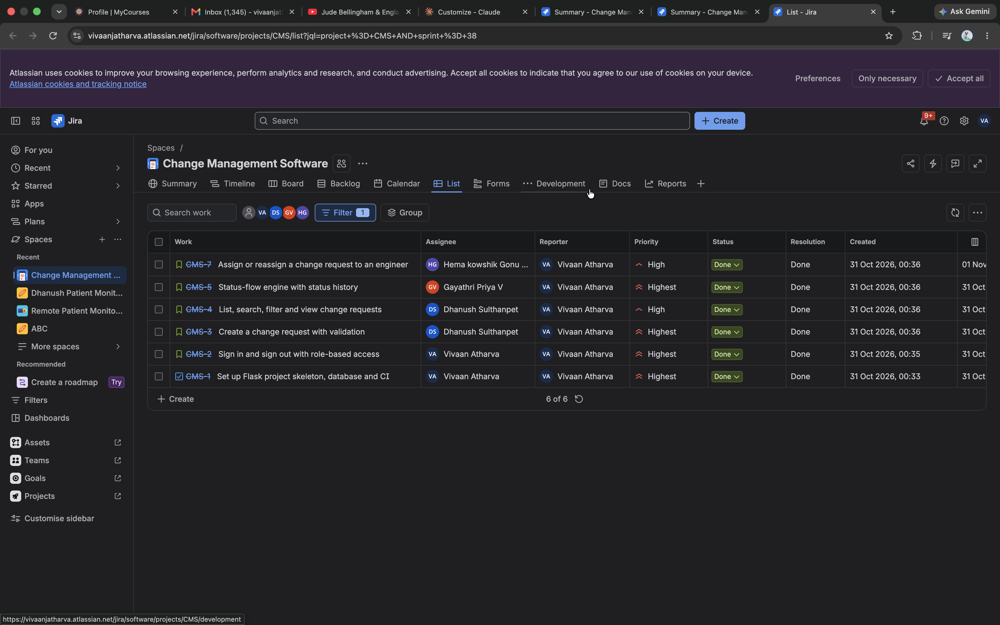
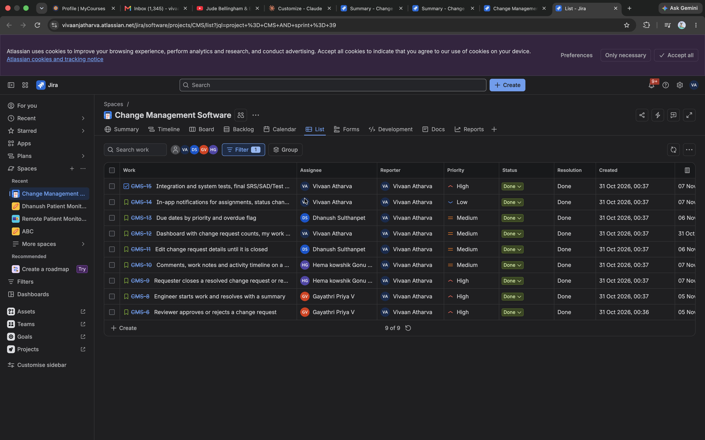
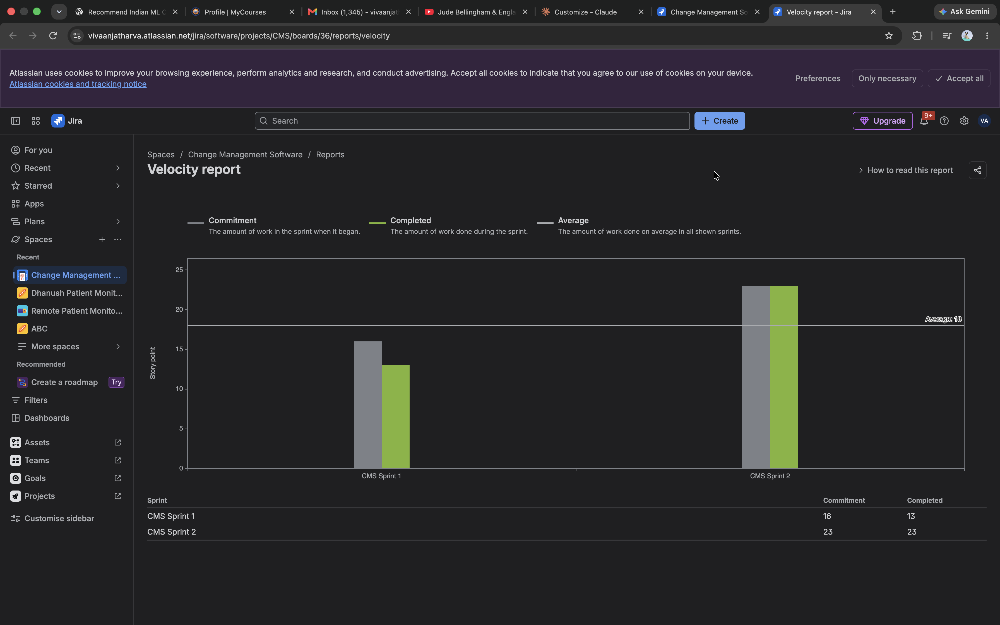
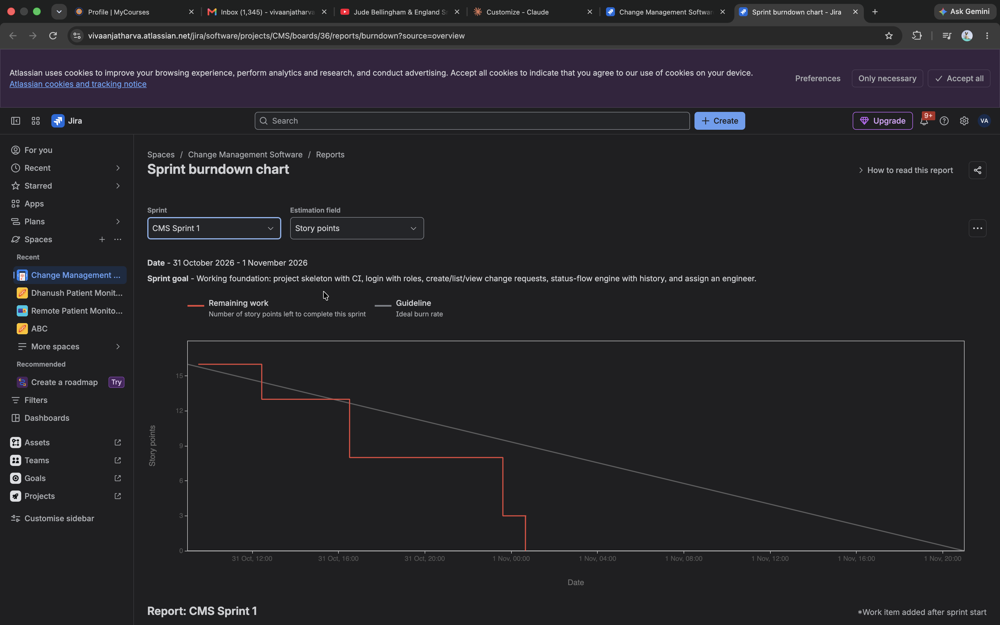
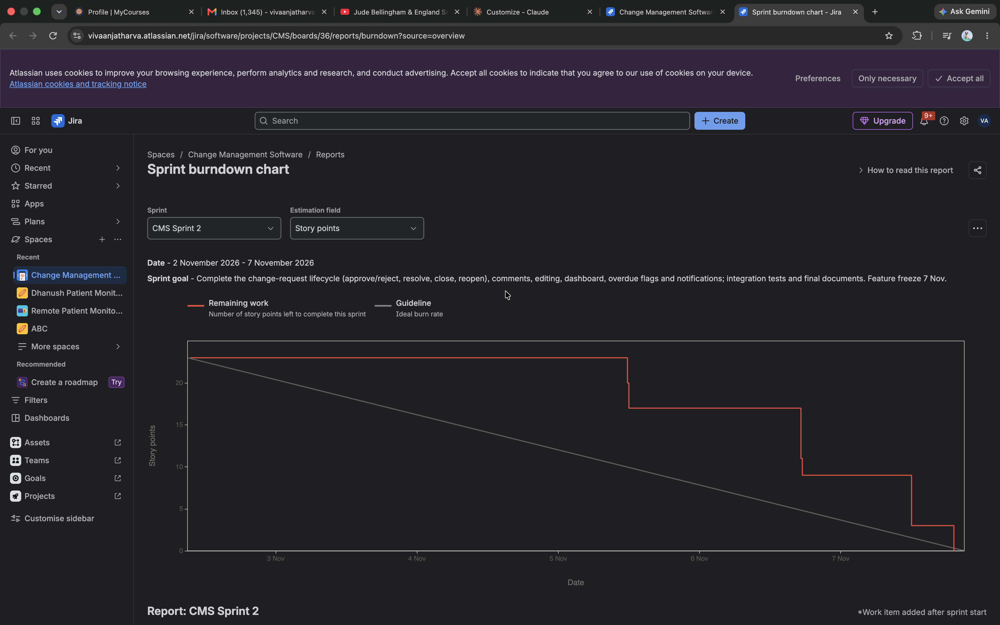

# Jira evidence: Agile process for CMS (Team 4)

Jira space: **Change Management Software** (key `CMS`), team-managed Scrum, on `vivaanjatharva.atlassian.net`.
15 work items, 50 story points, 2 sprints, all items Done.

## Screenshots

| What | File |
|---|---|
| Jira dashboard / board |  |
| Product backlog (all 15 items with points, sprint and owner) |  |
| Sprint 1 backlog |  |
| Sprint 2 backlog |  |
| Sprint progress |  |
| Sprint 1 burndown |  |
| Sprint 2 burndown |  |

## Sprints

| Sprint | Dates | Goal | Items | Points | Result |
|---|---|---|---|---|---|
| CMS Sprint 1 | 31 Oct – 1 Nov 2026 | Working foundation: project skeleton with CI, login with roles, create/list/view change requests, status-flow engine with history, and assign an engineer. | 6 | 24 | All Done |
| CMS Sprint 2 | 2 – 7 Nov 2026 (feature freeze 7 Nov) | Complete the change-request lifecycle (approve/reject, resolve, close, reopen), comments, editing, dashboard, overdue flags and notifications; integration tests and final documents. | 9 | 26 | All Done |

## Product backlog

| Key | Type | Summary | Points | Sprint | Owner | Status | Pull request |
|---|---|---|---|---|---|---|---|
| CMS-1 | Task | Set up Flask project skeleton, database and CI | 3 | Sprint 1 | Vivaan Atharva | Done | #1 |
| CMS-2 | Story | Sign in and sign out with role-based access | 5 | Sprint 1 | Vivaan Atharva | Done | #2 |
| CMS-3 | Story | Create a change request with validation | 3 | Sprint 1 | Dhanush S S | Done | #4 |
| CMS-4 | Story | List, search, filter and view change requests | 5 | Sprint 1 | Dhanush S S | Done | #5 |
| CMS-5 | Story | Status-flow engine with status history | 5 | Sprint 1 | Gayathri Priya V | Done | #6 |
| CMS-7 | Story | Assign or reassign a change request to an engineer | 3 | Sprint 1 | Gonu Guntla Hema Kowshik | Done | #7 |
| CMS-6 | Story | Reviewer approves or rejects a change request | 3 | Sprint 2 | Gayathri Priya V | Done | #10 |
| CMS-8 | Story | Engineer starts work and resolves with a summary | 3 | Sprint 2 | Gayathri Priya V | Done | #9 |
| CMS-9 | Story | Requester closes a resolved change request or reopens it with a reason | 3 | Sprint 2 | Gonu Guntla Hema Kowshik | Done | #11 |
| CMS-10 | Story | Comments, work notes and activity timeline on a change request | 3 | Sprint 2 | Gonu Guntla Hema Kowshik | Done | #17 |
| CMS-11 | Story | Edit change request details until it is closed | 2 | Sprint 2 | Dhanush S S | Done | #13, #14 |
| CMS-12 | Story | Dashboard with change request counts, my work and overdue items | 3 | Sprint 2 | Vivaan Atharva | Done | #3 |
| CMS-13 | Story | Due dates by priority and overdue flag | 3 | Sprint 2 | Dhanush S S | Done | #12 |
| CMS-14 | Story | In-app notifications for assignments, status changes and comments | 3 | Sprint 2 | Vivaan Atharva | Done | #16 |
| CMS-15 | Task | Integration and system tests, final SRS/SAD/Test Plan and RTM | 3 | Sprint 2 | Vivaan Atharva | Done | #8, #15, #18 |

**Total: 50 story points.**

## How the sprints were run

- Each item has acceptance criteria and links to its SRS requirement IDs (see `docs/RTM.md`).
- Each item was built on a feature branch (`feature/CMS-<n>-…`), moved To Do → In Progress → Done in Jira, and merged through a reviewed pull request.
- GitHub Actions ran the full test suite on Ubuntu, Windows and macOS for every pull request; the final suite has 401 passing tests.
- CMS-12 was finished early during Sprint 1 and closed in Sprint 2. CMS-14 was reassigned from Hema to Vivaan during Sprint 2 so that Hema could finish CMS-10 before the feature freeze.
